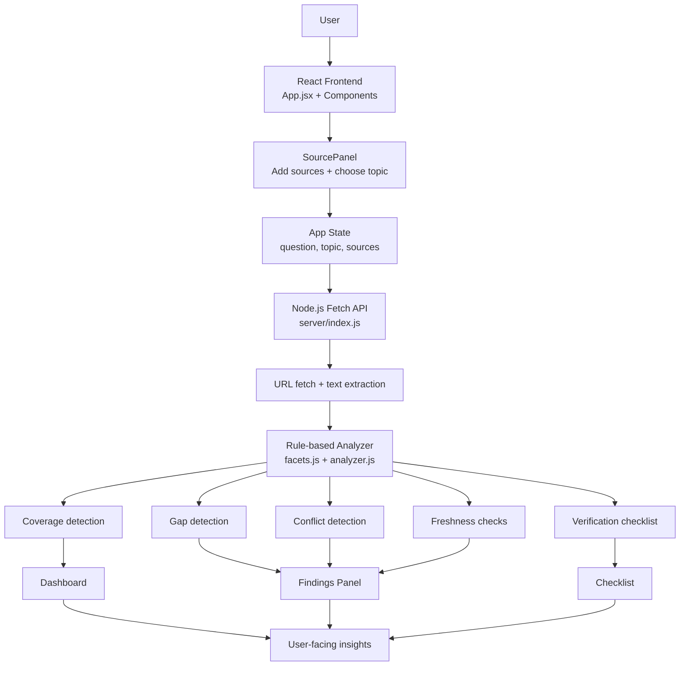

# 🖍️ Digital Dark Spot

A web app for discovering the missing, conflicting, and outdated information hidden inside a set of sources before making an important decision.

This project was created for the Shinchan Online Hackathon 2026 by Team DEVENGERS.

## Overview

Most search results and AI summaries give you a polished answer, but they often hide the uncertain parts:

- missing facts
- conflicting numbers or dates
- stale or outdated sources
- unanswered follow-up questions

Digital Dark Spot helps you find those gaps quickly. Instead of treating every result as equally trustworthy, it highlights what is missing, what conflicts, and what should be verified before acting.

It is designed for real-world decision contexts such as:

- scholarship applications
- job opportunities
- public service or eligibility checks
- policy or form-related research

## What the app does

The app lets users:

- add multiple source links or text snippets
- choose a topic profile such as scholarship, service, or job
- identify coverage gaps across those sources
- detect contradictions in figures, dates, documents, and claims
- flag stale or undated information
- generate a prioritized checklist of what to verify next

Every finding is traceable to a source and labeled as either:

- SOURCED: backed by a quote from a source
- SIGNAL: heuristic-based potential issue or inconsistency
- UNCERTAIN: missing or unconfirmed information

## Key features

### 1. Coverage and gap detection
Each topic has a set of expected facets such as eligibility, deadline, required documents, renewal status, or fee structure. The analyzer checks whether each facet appears in the collected sources.

If a facet is missing in all sources, it is flagged as a gap. If it appears in only one source, it is marked as unconfirmed.

### 2. Conflict detection
The app compares values across sources for things like:

- money amounts
- percentages
- dates and deadlines
- required document lists

If two sources disagree, a conflict is shown with the related evidence and source references.

### 3. Freshness checks
The app inspects whether source text includes dates, years, or cycle labels such as 2023-24. If a source is missing a clear date or contains outdated information, it is flagged for review.

### 4. Actionable verification checklist
Once analysis is complete, the app produces a ranked checklist of actions such as:

- resolve a conflict using the latest official notice
- confirm a missing fact with a second official source
- recheck whether a source is still current

### 5. Transparent, rule-based analysis
The logic is intentionally explainable and source-linked. It is not meant to guess facts with certainty; it surfaces uncertainty and missing evidence clearly.

## Tech stack

- React 18
- Vite 5
- Tailwind CSS 3
- Node.js server with fetch-based source retrieval
- Custom rule-based analysis engine

## Project structure

```text
.
├── README.md
├── index.html
├── package.json
├── postcss.config.js
├── tailwind.config.js
├── vite.config.js
├── public/
├── server/
│   └── index.js               # URL fetch + text/date extraction with basic guard checks
├── src/
│   ├── App.jsx                # main UI and app state
│   ├── index.css              # styles and theme
│   ├── main.jsx               # application entry point
│   ├── components/
│   │   ├── Badge.jsx
│   │   ├── Checklist.jsx
│   │   ├── Dashboard.jsx
│   │   ├── Evidence.jsx
│   │   ├── Findings.jsx
│   │   ├── SourcePanel.jsx
│   │   └── ...
│   └── lib/
│       ├── analyzer.js        # analysis engine
│       ├── facets.js          # topic profiles and rules
│       ├── sample.js          # demo dataset
│       └── ...
└── dist/                      # generated production build (after build)
```

## Working structure design

The application follows a simple layered architecture that separates source collection, analysis, and presentation.

### System architecture diagram



This diagram shows the full system design: the browser UI collects source data, the backend fetches/extracts content, the analyzer compares facts across sources, and the frontend renders the final findings and verification checklist.

### 1. Frontend layer
The React frontend is responsible for user interaction and UI rendering.

- `src/App.jsx` manages app-level state such as the selected topic, query, and submitted sources.
- `SourcePanel` collects source URLs or text and lets the user choose the decision topic.
- `Dashboard` presents the final result summary and high-level metrics.
- `Findings`, `Checklist`, `Evidence`, and `Badge` render the analysis output in an easy-to-read format.

This layer handles user inputs and displays structured results but does not perform deep verification logic itself.

### 2. Analysis layer
The core logic is kept in the `src/lib` folder.

- `src/lib/facets.js` defines the topic profiles and facet rules. Each topic includes expected details such as documents, eligibility rules, fees, deadlines, and renewal criteria.
- `src/lib/analyzer.js` performs the analysis by:
  - splitting sources into sentences
  - matching evidence against facets
  - identifying gaps and missing facts
  - comparing values across sources for conflicts
  - checking freshness and outdated signals
  - generating a verification checklist

This is where the app turns raw source text into actionable insights.


### 3. Source processing model
Each source is treated as a separate evidence block with its own text and metadata. The analyzer evaluates each source independently and then compares source-to-source patterns for contradiction or missing coverage.

This allows the app to answer questions like:

- what is covered by at least one source?
- what is missing everywhere?
- which data conflicts across sources?
- which source is stale or undated?

### 4. Component interaction design
The design is intentionally modular:

- input collection and topic selection are separate from output rendering
- analysis is isolated from UI concerns
- findings are generated once and then rendered by specialized components

This keeps the system easier to extend, test, and update with newer logic later.

## Prerequisites

Before running the app, make sure you have:

- Node.js 18 or later
- npm

## Installation

From the project root, run:

```bash
npm install
```

This installs the React app and the development dependencies needed to run the project.

## Run the app locally

### Development mode

```bash
npm run dev
```

This starts:

- the frontend on http://localhost:5173
- the backend API on http://localhost:3001

### Frontend only

```bash
npm run web
```

### API only

```bash
npm run api
```

### Production build

```bash
npm run build
```

This creates a production-ready build in the `dist/` folder.

## How the detection engine works

The analyzer uses a rule-based approach designed to be transparent and explainable.

### 1. Topic facets
Each decision domain has a set of expected details. For example, a scholarship may need:

- eligibility
- application deadline
- required documents
- renewal rules
- funding amount

The app checks whether each of these topics is covered across the user-provided sources.

### 2. Evidence extraction
The system splits source text into sentences and matches patterns relevant to each facet. It then collects matching evidence per source.

### 3. Gap scoring
If a facet is absent in all sources, it is a clear gap. If it appears in only a single source, it is treated as partially confirmed and therefore risky.

### 4. Conflict analysis
The analyzer detects mismatches in:

- numbers (money, percentages)
- dates
- document requirements
- category-specific values

### 5. Freshness analysis
The app checks for:

- embedded years in the text
- explicit dates or update timestamps
- cycle labels such as `2024-25`
- missing dates that reduce confidence

### 6. Verification checklist generation
Finally, the system creates a prioritized list of actions to close the evidence gaps and resolve contradictions.

## Demo flow

The app includes a sample dataset so you can see the full workflow quickly.

1. Open the app in the browser.
2. Click `Load sample`.
3. Review the source set and detected findings.
4. Inspect the checklist for recommended verification tasks.

This gives a fast demonstration of how the analysis works without needing to paste a large set of sources manually.

## Example usage

A typical workflow is:

```text
1. Collect 2 or more sources about the same decision.
2. Paste or add their URLs/text.
3. Select the decision domain (for example, scholarship).
4. Run analysis.
5. Review gaps, conflicts, and fresh/dated issues.
6. Prioritize what to verify next.
```

## Limitations

This version uses rule-based search and matching rather than deep semantic reasoning. That means:

- paraphrased claims may be missed
- some contradictions may require human interpretation
- context-specific nuance may not always be captured

The app is intended as a transparent decision-support tool, not a guarantee of truth.

## Future improvements

Planned enhancements include:

- semantic contradiction detection
- better extraction from PDFs and long-form documents
- broader search API integration
- multilingual support
- exportable reports
- stronger LLM-assisted claim extraction while preserving source traceability

## Why this project matters

In a world where information is fragmented and AI-generated summaries often sound authoritative, Digital Dark Spot helps users ask the more important question:

> What do I still not know, and what do I need to verify before I trust this decision?

This project is designed to make uncertainty visible, source-backed, and actionable.
